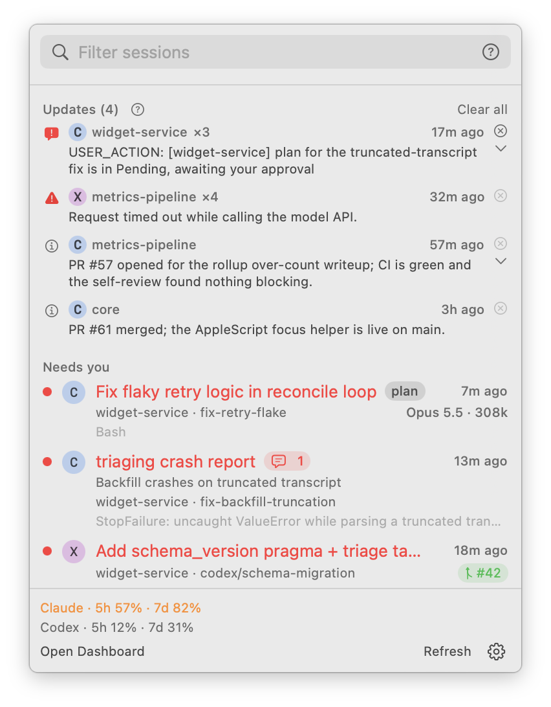
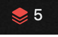
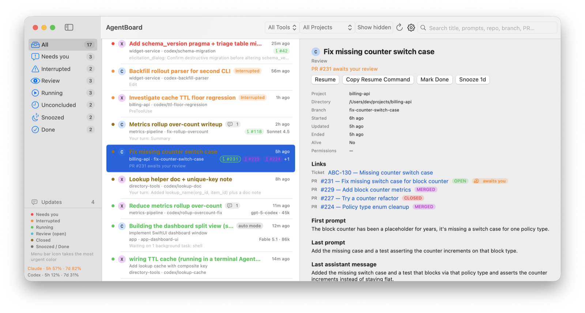
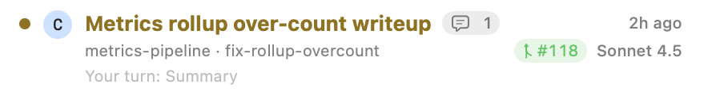
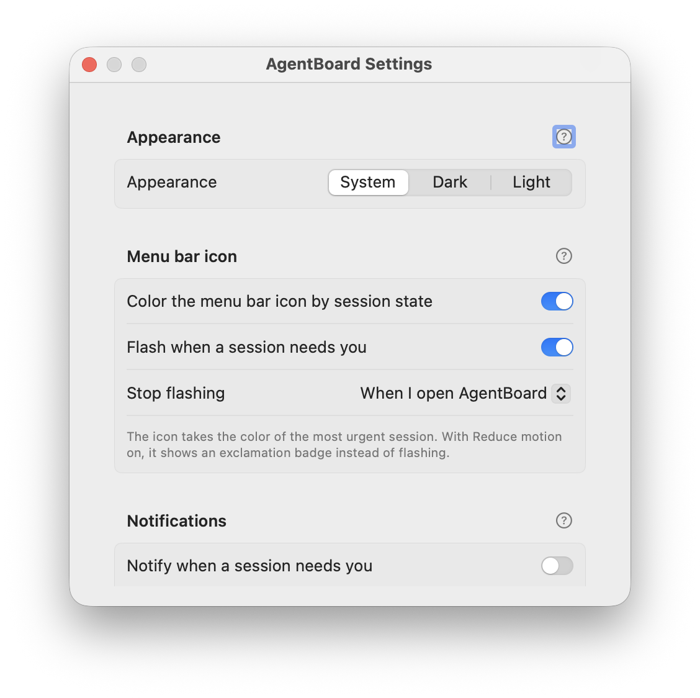

# AgentBoard

When several Claude Code or Codex CLI sessions run in different terminal tabs, it is easy to lose
track of which one is blocked on you. AgentBoard puts them all behind one menu bar icon that turns
red when a session needs you. It shows which sessions finished a turn and have something for you
to review, which are running, and which older work never wrapped up. Click a session to jump to
its iTerm2 or Terminal tab. It runs entirely on your Mac, with no server, no account and no
telemetry.

<p align="center">
  <picture>
    <source media="(prefers-color-scheme: dark)" srcset="docs/images/popover-dark.png">
    
  </picture>
</p>

[Quick start](#quick-start) · [What you see](#what-you-see) · [Requirements](#requirements) ·
[Install](#install) · [Uninstall](#uninstall) · [Configure](#configure) · [Features](#features) ·
[Hooking in your own tools](#hooking-in-your-own-tools) · [Privacy](#privacy) ·
[Troubleshooting](#troubleshooting) · [More documentation](#more-documentation) ·
[License](#license)

## Quick start

```
git clone https://github.com/AMPWorks/agentboard.git && cd agentboard
scripts/install.sh --dry-run     # see exactly what would change
scripts/install.sh
```

Then start a Claude Code or Codex session as usual: it appears in the menu bar. Codex users run
`/hooks` inside Codex once to trust AgentBoard's hooks.

## What you see

Every session is in exactly one state. The first rule that applies wins, in this order:

| State | Color | When |
|---|---|---|
| Done | gray | You marked it done, or it finished on its own: a clean exit, its PRs merged, or a link reported done. |
| Snoozed | gray | You snoozed it; it comes back when the snooze runs out. |
| Needs you | red | It is blocked on you: a permission prompt, a question, a failed turn, or an open request it left for you. |
| Interrupted | orange | It was working, but its process died or went quiet. |
| Review | teal, amber once exited | It has something for you to act on, and the row says what: "Your turn", a PR that awaits your review, or an update. |
| Running | green | It is working right now. |
| Unconcluded | amber | Anything not finished and not waiting on you, such as todos left open or a session that ended mid-turn. |

The menu bar icon takes the color of the most urgent session, and it flashes red when a session
newly needs you until you have seen it. The numbers next to it count the sessions that need you
or were interrupted, then (dimmer) the ones in Review.

<picture>
  <source media="(prefers-color-scheme: dark)" srcset="docs/images/menu-bar-icon-dark.png">
  
</picture>

The popover (click the icon) lists the sessions that matter now. The dashboard (⌃⌥⌘A, or **Open
Dashboard** in the popover) is a full window with every session, filters by state, tool and
project, and a detail pane for the selected session.

<picture>
  <source media="(prefers-color-scheme: dark)" srcset="docs/images/dashboard-dark.png">
  
</picture>

Each row shows the session's title, project and branch, and what it is waiting on. It also has a
button per PR (`#N`, green while open, outlined when it awaits you), a count of open updates, the
permission mode (`plan`, `auto`, ...) while the session is live, and the model and context size,
such as `Opus 5.5 · 308k`.

<picture>
  <source media="(prefers-color-scheme: dark)" srcset="docs/images/session-row-dark.png">
  
</picture>

Full rules: [State](docs/REFERENCE.md#state) and [Menu bar icon](docs/REFERENCE.md#menu-bar-icon).

## Requirements

- macOS 14 or newer.
- Python 3.11 or newer. A bare `python3` that is older is fine as long as a `python3.11` to
  `python3.14` is on `PATH` (for example `brew install python@3.12`).
- Xcode Command Line Tools, for the app. Without them you get the hooks only; re-run later. If
  their default macOS SDK can't build SwiftUI's macros, the build picks an older installed SDK
  on its own ([Building the app](docs/REFERENCE.md#building-the-app)).
- Claude Code, Codex CLI, or both.
- Optional: the GitHub CLI `gh`, signed in, for PR buttons and "awaits your review".

## Install

Run `scripts/install.sh` from a checkout, as in [Quick start](#quick-start). It:

- checks the prerequisites and picks a Python 3.11 or newer;
- copies the CLI into a stable location, so the hooks never run from your checkout;
- builds the menu bar app and installs it (quitting and relaunching a running copy);
- installs hooks for whichever of Claude Code and Codex are present, backing up each file;
- imports the last 30 days of session history, then launches the app.

| What | Where |
|---|---|
| The app | `~/Applications/AgentBoard.app` (`--prefix DIR` to change) |
| The CLI the hooks run | `~/.local/share/agentboard/core` (`AGENTBOARD_CORE_DIR` to change) |
| Hook entries | `~/.claude/settings.json` and `~/.codex/hooks.json` |
| Data, config and logs | `~/Library/Application Support/AgentBoard` (`AGENTBOARD_HOME` to change) |

`install.sh` is idempotent. Re-run it to upgrade after pulling, and after installing Claude Code
or Codex for the first time, since a tool that was missing at install time gets no hooks. Codex
0.124 and newer run hooks by default; for an older Codex, `--enable-codex-hooks` adds
`hooks = true` to `~/.codex/config.toml`. Either way, trust the hooks with `/hooks` inside Codex,
and again when `install.sh` warns that an upgrade changed them.

| Flag | Effect |
|---|---|
| `--dry-run` | Show what would change, including a diff of each hooks file, and change nothing. |
| `--no-app` | Skip building and installing the app. |
| `--no-hooks` | Skip installing hooks. |
| `--enable-codex-hooks` | Turn on Codex hooks in `~/.codex/config.toml` (backed up first). |

Details: [Install / uninstall](docs/REFERENCE.md#install--uninstall).

## Uninstall

```
scripts/uninstall.sh [--dry-run] [--purge-data]
```

It removes the app, the installed CLI and only AgentBoard's own hook entries; other hooks in the
same files stay. A hooks file nothing else has touched since the install is restored byte for
byte from its backup. The data directory stays unless you pass `--purge-data`, and an edit made
by `--enable-codex-hooks` is left in place, with its backup beside it. Details:
[Install / uninstall](docs/REFERENCE.md#install--uninstall).

## Configure

Most people only need the Settings window: gear menu (in the popover footer or the dashboard
toolbar) → **Settings…**.

<picture>
  <source media="(prefers-color-scheme: dark)" srcset="docs/images/settings-dark.png">
  
</picture>

- **Appearance**: System, Dark or Light for AgentBoard's windows.
- **Menu bar icon**: color the icon by session state, flash when a session needs you, and when
  the flash stops.
- **Notifications**: notify when a session needs you, and when a session finishes a turn (both
  off by default).
- **General**: launch at login, show plan usage, and show closed and merged PRs on rows.
- **CLI & Data**: a path to the `agentboard` CLI, if the app cannot find it.
- **Diagnostics**: verbose logging and **Open log**.

The CLI reads an optional `config.json` in the data directory (`agentboard paths` prints where).
It does not exist until you create it, every key is optional, and each command reads it fresh.
The keys people change most:

| Key | Default | What it does |
|---|---|---|
| `automation_logins` | none | GitHub logins (a reviewer bot, an author bot) whose reviews and comments do not count as yours. |
| `ticket_patterns` | none | Regexes that turn ticket references in branch names and first prompts into links. |
| `providers` | none | External commands that report links for sessions. |
| `prune_days` | `90` | Delete sessions idle this many days; `0` never deletes. |
| `retitle_command` | the local `claude` CLI | Generates titles that follow the work; `null` turns retitling off. |
| `log_level` | `info` | The diagnostic log's level: `debug`, `info`, `warn` or `error`. |

Every key: [Configuration (config.json)](docs/REFERENCE.md#configuration-configjson).

## Features

**Menu bar icon.** One color for the whole board, so you can tell whether anything needs you
without opening it. With Reduce motion on, the icon shows a badge instead of flashing.
[More](docs/REFERENCE.md#menu-bar-icon)

**Notifications.** Optional macOS notifications when a session needs you or finishes its turn.
Clicking one brings the session's terminal tab to the front, and your next prompt in that session
clears its finished-turn notification. [More](docs/REFERENCE.md#notifications)

**Search.** The popover and the dashboard share one search: every word must match, quotes keep
a phrase together, and qualifiers such as `branch:`, `state:`, `repo:` and `pr:` narrow a word.
[More](docs/REFERENCE.md#search)

**PRs and links.** With `gh` installed, each session gets buttons for its PRs. A PR the session
opened keeps it in Review as "PR #N awaits your review" until someone other than automation
responds or it merges. Titles follow the work: after a few new prompts the local `claude` CLI
renames a long-running session. [More](docs/REFERENCE.md#links--integrations)

**Updates.** Sessions that run unattended say a lot, and little of it needs you. AgentBoard keeps
the few messages worth reading (a request marked `USER_ACTION:`, a PR opened or merged, CI going
red) as updates in the popover until you dismiss them. An open request turns its session red.
[More](docs/REFERENCE.md#updates-retained-notes)

**Plan usage, model and context.** When Claude Code or Codex reports plan usage on this Mac, the
popover footer shows how much of each limit window is used and when it resets. Each row shows
the model the session last ran and its context size. [More](docs/REFERENCE.md#plan-usage-and-context)

**Retention.** Once a day the app deletes sessions idle for 90 days, except one with an open
request, a PR awaiting you, an active snooze or a live process, and it compacts tool-use events
older than a week. [More](docs/REFERENCE.md#data)

**Jump to the terminal.** Clicking a row focuses its tab in iTerm2 or Apple Terminal. For other
terminals AgentBoard brings the terminal app to the front.
[More](docs/REFERENCE.md#links--integrations)

## Hooking in your own tools

AgentBoard knows no ticket system, team or host; everything specific comes in through generic
hooks of its own:

- `agentboard link`, `agentboard status`, `agentboard note` and `agentboard title`, run from
  inside a session, report a PR or ticket, a status label, an update or a title for it;
- a JSON file dropped into the data directory's `inbox/` does the same for tools that cannot run
  the CLI;
- `providers` in `config.json` lists commands that `agentboard refresh-links` runs to report links
  for every open session;
- `usage/<source>.json` in the data directory adds a plan-usage line for any agent.

Details: [Links & integrations](docs/REFERENCE.md#links--integrations) and the
[CLI reference](docs/REFERENCE.md#cli-reference).

## Privacy

AgentBoard has no server, no account and no telemetry; everything it records stays in its data
directory on your Mac. Besides that directory it reads only Claude Code's and Codex's own files
under `~/.claude` and `~/.codex`, and each session's git branch. The snapshot the app polls never
touches the network. Only `agentboard refresh-links` does, through tools you set up: `gh` for PRs
and their reviews, your provider commands, and the retitle command, which by default runs your
local `claude` CLI to send a short summary of a session's recent prompts and replies to the
model. Set `"retitle_command": null` in
`config.json` to turn retitling off. Details: [Diagnostics](docs/REFERENCE.md#diagnostics) and
[Data](docs/REFERENCE.md#data).

## Troubleshooting

- The app has a built-in guide: gear menu → **AgentBoard Help**. Its **Diagnostics and
  troubleshooting** topic covers the common problems (no sessions, missing Codex sessions, no PR
  buttons, the wrong tab focused).
- A banner under the popover's search field says when something is wrong, with **Open log**.
- `agentboard logs` prints the diagnostic log; `agentboard logs --grep cli.focus` explains a
  click that focused the wrong tab.
- No sessions at all: re-run `scripts/install.sh`, especially after installing Claude Code or
  Codex. No Codex activity: trust the hooks with `/hooks` inside Codex.

Details: [Diagnostics](docs/REFERENCE.md#diagnostics) and [Help](docs/REFERENCE.md#help).

## More documentation

- [docs/REFERENCE.md](docs/REFERENCE.md): the full reference, for maintainers and agents:
  [Hooks](docs/REFERENCE.md#hooks), [State](docs/REFERENCE.md#state),
  [Configuration](docs/REFERENCE.md#configuration-configjson),
  [CLI reference](docs/REFERENCE.md#cli-reference) and
  [Diagnostics](docs/REFERENCE.md#diagnostics).
- [docs/DEVELOPMENT.md](docs/DEVELOPMENT.md): the components, running the tests, and
  regenerating the screenshots.
- [LOG.md](LOG.md): the development log, a narrative of decisions and milestones.
- [SPEC.md](SPEC.md): the original design contract.
- [CLAUDE.md](CLAUDE.md): the guide for agents working on the code.

## License

MIT; see [LICENSE](LICENSE).
